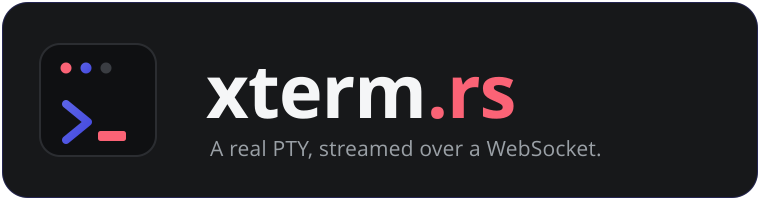

<p align="center">
  
</p>

<p align="center">
  <strong>The browser terminal that doesn't fake it.</strong><br>
  A tiny Rust backend that streams a real PTY over a WebSocket.
</p>

<p align="center">
  <a href="https://term.hack.courses">Live demo</a> ·
  <a href="https://hack.courses">hack.courses</a> ·
  <a href="https://fenrir.pro/contact">Contact</a>
</p>

---

`xterm_rs` spawns a genuine shell on a pseudo-terminal, gives it a controlling
terminal, and pipes it to an [`xterm.js`](https://xtermjs.org) frontend over a
WebSocket. Job control, Unix signals, full-screen TUIs and live resize all work,
because the kernel's line discipline is doing the work, not a lookup table.

It is one static binary and an `xterm.js` page. Drop it in, point `--cmd` at a
shell or a lesson launcher, and you are exposing a real interactive terminal to a
web page.

We build it at [fenrir.pro](https://fenrir.pro) and run it under every IT and
ethical-hacking lab on [hack.courses](https://hack.courses).

## The difference

Most "web terminals" are a transcript: they match your input against a fixed
command list and print canned output. It looks right until you press `Ctrl-C` or
open an editor. `xterm_rs` is a process.

| | Faked terminal | `xterm_rs` |
|---|---|---|
| Output | matched from a command list | a real `bash` on a real PTY |
| `Ctrl-C` / `Ctrl-Z` | ignored, no signals | deliver `SIGINT` / `SIGTSTP` |
| `vim`, `htop`, `tmux` | can't render | render byte-for-byte |
| Window resize | changes nothing | fires a real `SIGWINCH` |
| Job control, `/dev/tty` | none | session leader with a controlling terminal |

## Features

Each connection gets its own pseudo-terminal, set up as a session leader with the
slave as its controlling terminal. `Ctrl-C`, `Ctrl-Z`, background jobs, `fg`,
`tcsetpgrp` all route through the kernel's line discipline rather than a polyfill,
so cursor-addressed programs like `vim`, `htop`, `tmux`, `less` and `nano` render
exactly as they would in a native terminal. The frontend reports its column and
row count, the backend issues `TIOCSWINSZ`, and the process receives a
`SIGWINCH`. Point `--cmd` at a shell, a single program, or your own launcher, and
optionally exit when it does. The whole stack is one self-contained Rust binary
with no runtime to install, plus `xterm.js` in the browser talking to it over a
WebSocket.

## Quick start

Build the binary:

```bash
cargo build --release
```

Run it:

```bash
./target/release/xterm_rs --cmd "bash -i"
```

Open `http://localhost:8080/term`. The server ships its own `xterm.js` page, so
there is nothing else to serve. You land in a working shell.

> The built-in page lives at `/term`; it rewrites that path to `/ws` for the
> WebSocket. Loading `/term` is what wires the browser to the backend.

## Options

Flags are parsed by `structopt`:

| Flag | Default | Description |
|---|---|---|
| `--host <HOST>` | `0.0.0.0` | Address to bind. |
| `--port <PORT>` | `8080` | Port to bind. |
| `--cmd <CMD>` | `bash -i` | Command to run in the PTY. A shell, a single program, or your own launcher. |
| `--https` | off | Emit `wss://` in the served page instead of `ws://`. Use behind a TLS-terminating proxy. |
| `--exit-with-process` | off | Shut the server down when the PTY process exits or `Ctrl-D` is received. Useful for one-shot, single-session launchers. |

Examples:

```bash
# Drop users straight into htop
./target/release/xterm_rs --cmd htop

# Open a file in vim, exit the server when the editor closes
./target/release/xterm_rs --cmd "vim /etc/fenrir/welcome.txt" --exit-with-process

# Behind a proxy that terminates TLS
./target/release/xterm_rs --https --host 127.0.0.1 --port 9000
```

## How it works

The backend spawns the child in a `pre_exec` hook that runs in the forked process
before `exec`, using async-signal-safe raw syscalls only. It calls `setsid` to
become a session leader with no controlling terminal, claims the PTY slave with
`ioctl(TIOCSCTTY)`, and wires the slave to stdin, stdout and stderr with `dup2`.
That is the piece naive setups miss, the reason they fall back to
`python3 -c 'pty.spawn(...)'`. The slave is left in its default cooked mode so
`bash` and `readline` configure the line discipline themselves; forcing raw mode
would clear `ISIG` and turn `Ctrl-C` into a literal byte instead of a `SIGINT`.
The child runs with `TERM=xterm-256color` and a sane 80x24 default until the
browser's first resize lands.

The wire protocol over `/ws` is deliberately small:

- **Keystrokes** travel as binary WebSocket frames, written straight to the PTY
  master.
- **Resize** is a JSON text frame, `{"cols": <n>, "rows": <n>}`, which the backend
  turns into a `TIOCSWINSZ` `ioctl`.
- **Output** from the PTY streams back as binary frames for `xterm.js` to render.

When `--exit-with-process` is set, a `Ctrl-D` (`0x04`) from the browser or the
child exiting triggers a graceful shutdown; otherwise `0x04` is filtered out so an
accidental EOF does not kill the session.

### Bring your own frontend

The built-in page is convenient, but the backend only cares about the WebSocket.
Any `xterm.js` frontend works if it:

1. connects a binary WebSocket to `/ws`,
2. sends keystrokes as binary frames,
3. sends `{"cols", "rows"}` as a JSON text frame on connect and on every resize,
4. writes incoming binary frames into the terminal.

## Demo

[`demo/`](demo/) is a single-page showcase that embeds three sandboxed back-ends
(a shell, `htop`, and `vim`) so visitors can prove to themselves it is a real PTY.
It is the deployment behind [term.hack.courses](https://term.hack.courses).

```bash
cd demo
docker compose up --build
```

Then open `http://localhost:8080`. See [`demo/README.md`](demo/README.md) for the
service layout and per-container hardening.

## Security

These terminals hand a **real shell** to anyone who can reach the port. Treat the
binary as what it is: remote code execution by design. Before exposing it on the
open internet:

1. **Put authentication in front of it.** A reverse proxy with auth, or a tokened
   entry point. Never publish the raw port.
2. **Restrict egress** so a shell can't pivot. Attach the container to an
   `internal` network or firewall its outbound traffic.
3. **Terminate TLS at the edge** and run with `--https` (or proxy `wss://`) so the
   served page avoids mixed-content blocks.
4. **Drop privileges and cap resources.** Run as a non-root user, `cap_drop: ALL`,
   `no-new-privileges`, and per-container `pids_limit` and `mem_limit`. Consider a
   read-only rootfs with `tmpfs` for writable paths if sessions are untrusted.

The demo compose file is tuned for a local lab, not the open internet. Read
[`demo/README.md`](demo/README.md) before deploying anything reachable.

## Built to teach

Every IT and ethical-hacking lab on [hack.courses](https://hack.courses) is a real
machine in a browser tab, powered by `xterm_rs`. No VMs to install, nothing to
configure. Learners land in a working terminal and start breaking, and fixing,
things from the first minute.

Want a real terminal inside your product, or a hand getting it deployed and locked
down? We run this across our own security training and tooling and we are happy to
help: [fenrir.pro/contact](https://fenrir.pro/contact).

---

<sub>Made in-house at <a href="https://fenrir.pro">fenrir.pro</a>. © 2026 fenrir.pro</sub>
